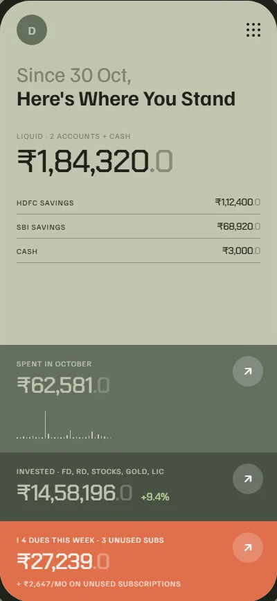
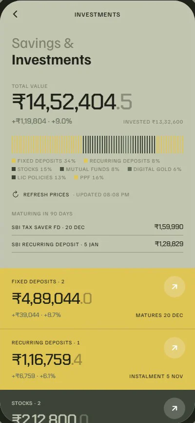
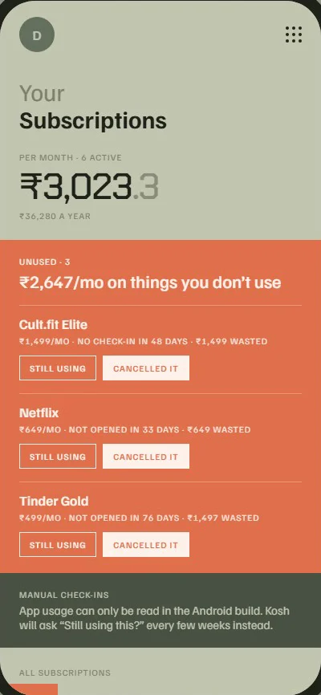

<p align="center">
  
</p>

<p align="center"><b>Your money, read from your SMS, kept on your phone.</b><br>
A private, offline-first personal finance app for Android in India (INR).</p>

<p align="center">
  <a href="https://github.com/Abhijat-Abhijat/kosh/actions/workflows/ci.yml"></a>
  <a href="https://abhijat-abhijat.github.io/kosh/"></a>
  <a href="LICENSE"></a>
  
  <a href="https://github.com/Abhijat-Abhijat/kosh/releases/latest"></a>
</p>

<p align="center">
  
  
  
</p>

## Features

- **Automatic expense logging** – reads bank, card and UPI SMS on the phone, parses amount, merchant, account and balance, and files the transaction. OTPs, promos, reminders and failed payments are ignored.
- **Accounts and cards** – match SMS to accounts by their last 4 digits; balances update from the latest SMS.
- **Savings and investments** – FD, RD, stocks, mutual funds, digital gold, LIC and PPF. Stock, MF NAV and gold prices refresh on demand.
- **Pending payments** – card bills, premiums and instalments with local reminders two days before and on the due date.
- **Unused subscriptions** – spots subscriptions you pay for but haven't opened in 30+ days (Android usage access) and sends a weekly digest.
- **Check-in nudges** – occasional reminders to review your money.
- **App lock** – fingerprint, face or device PIN.
- **Backups you control** – export everything to a JSON file, restore it on a new phone, or erase it all.
- **No account, no server** – all data lives in a local database on your phone.

## Why not on the Play Store?

Google Play only allows `READ_SMS` for default SMS apps and a few other narrow cases, and an expense tracker doesn't qualify. Kosh is distributed as a signed APK on [GitHub Releases](https://github.com/Abhijat-Abhijat/kosh/releases) instead. Each release has a SHA-256 checksum next to the APK so you can check the download.

## Quick start

1. Download the latest `kosh-<version>.apk` from [Releases](https://github.com/Abhijat-Abhijat/kosh/releases/latest).
2. Install it, then grant SMS, Usage access and notification permissions.
3. Add your accounts with their last 4 digits.

Step-by-step guide, backups and troubleshooting: **[docs/INSTALL.md](docs/INSTALL.md)**.

## Build from source

```bash
npm ci
npx expo run:android
```

Requirements, release signing and the Windows long-path note are in **[docs/BUILDING.md](docs/BUILDING.md)**. How the code is organised: **[docs/ARCHITECTURE.md](docs/ARCHITECTURE.md)**.

## Tech stack

Expo SDK 58 · React Native 0.88 · Expo Router · NativeWind 4 · TanStack Query · Zustand · React Hook Form + Zod · expo-sqlite · expo-secure-store · expo-notifications · optional Sentry. A local Expo module in Kotlin (`modules/kosh-native`) reads SMS and app-usage stats.

## Privacy

- No accounts, no analytics, no ads, no server.
- SMS are parsed on the phone; only matched transaction messages are stored, in the app's private database.
- The only network calls are optional price lookups (Yahoo Finance, mfapi.in) for holdings you add, and crash reports only if whoever built the APK set a Sentry DSN (official releases don't).

Details: [docs/PRIVACY.md](docs/PRIVACY.md) · Security model and reporting: [SECURITY.md](SECURITY.md).

## Contributing

Bug reports, new bank SMS formats and pull requests are welcome. Read [CONTRIBUTING.md](CONTRIBUTING.md) and the [Code of Conduct](CODE_OF_CONDUCT.md). If your bank's SMS aren't recognised, [open an SMS format request](https://github.com/Abhijat-Abhijat/kosh/issues/new?template=sms_format.yml) with a **redacted** sample.

## License

[MIT](LICENSE) © 2026 Kosh contributors
